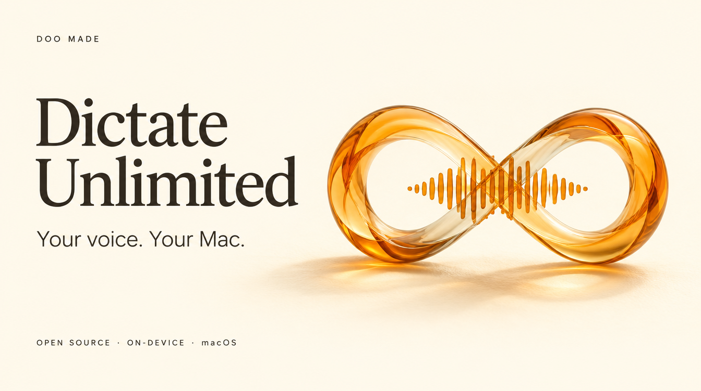
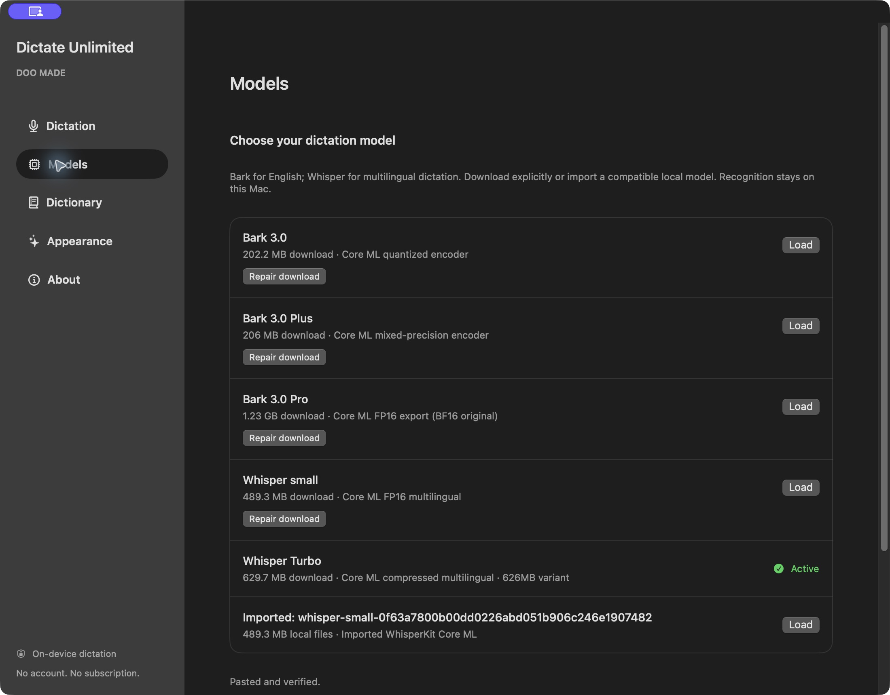
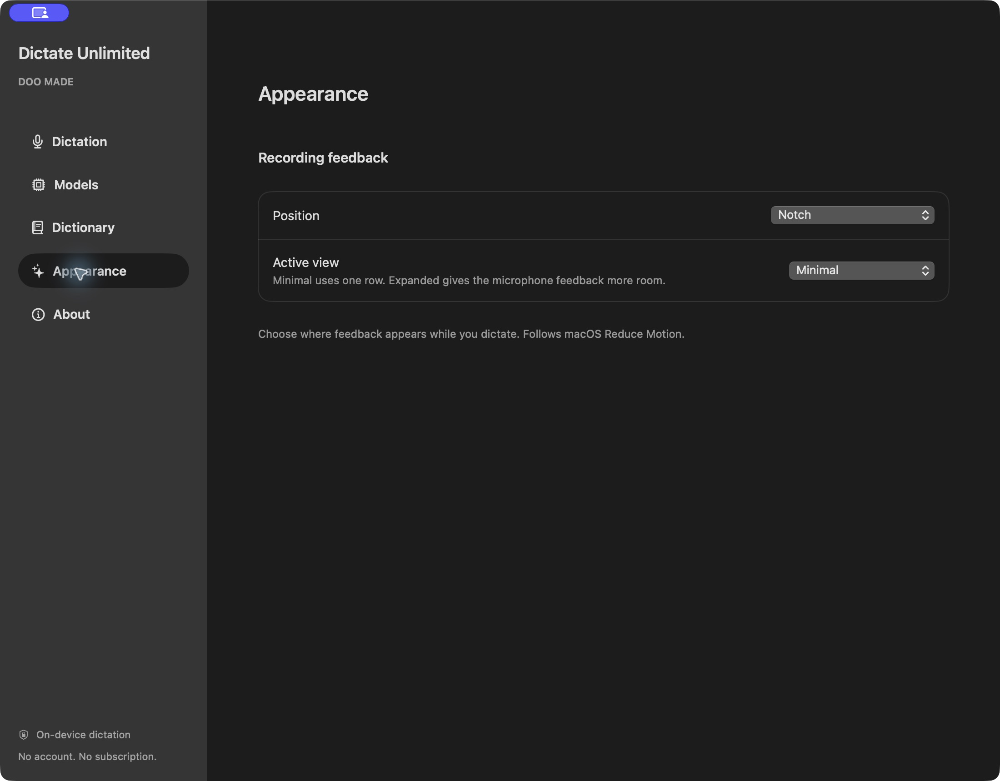

# Dictate Unlimited

**Free, local voice dictation for your Mac. Built by DOO MADE.**

Speak into the app you're already using. Choose a Bark or Whisper model, hold or tap
a shortcut, and turn speech into text on your Mac. No account, subscription, cloud
inference, or telemetry.

**V1.1 source preview · Apple Silicon · macOS 15+ · English and multilingual dictation**

This release is for people comfortable building from source. A signed, notarized
app download is not available yet. There is no usage quota; each recording has a
five-minute limit. Recognition quality and insertion support vary by model and app.

[Get started](#build-from-source) · [Usage](docs/USAGE.md) · [Report a bug](https://github.com/DanielJD1216/dictate-unlimited/issues/new/choose) · [Contribute](CONTRIBUTING.md)

## What it does

- **Five on-device models.** Bark 3.0, Bark 3.0 Plus, Bark 3.0 Pro, Whisper small, and Whisper Turbo. Download explicitly, then transcribe offline. Your selected installed model loads on launch.
- **Hold or tap to dictate.** Configurable dictation and recovery shortcuts, with notch or floating feedback.
- **Microphone readiness.** Choose an input and run a five-second signal check before recording.
- **Text delivery.** Clipboard paste into supported focused fields, with Accessibility checks and delivery feedback. Never sends Enter.
- **Paste-last recovery.** Insert the last completed result into your current field without recording again.
- **Local dictionary.** Explicit word and phrase corrections, with edit, remove, and undo. No automatic learning.
- **Cancel and recover.** Discard recordings or suppress unfinished recognition. No recording or transcript history is saved.

## The app

Real screenshots from the local preview build. The banner above is illustrative artwork.



<details>
<summary>Recording feedback settings</summary>



</details>

## Build from source

You need an **Apple Silicon Mac**, **macOS 15 or newer**, and a **Swift 6.2 toolchain**.
Check `swift --version` first. Git and `curl` are used to acquire pinned dependencies.
Python 3.11+ and ripgrep (`rg`) are needed for developer checks; the app itself does
not use a Python runtime.

```sh
git clone https://github.com/DanielJD1216/dictate-unlimited.git
cd dictate-unlimited
./scripts/build-app.sh
open 'dist/Dictate Unlimited.app'
```

The first build downloads dependencies. Open **Models**, download a model, then
choose **Load**. First-time Core ML preparation can take several minutes.

In **Dictation**, grant Microphone and Accessibility access. Click into your writing
app before using the shortcut. Keep the built app at one stable path when granting
permissions. This development build is ad-hoc signed: after rebuilding, macOS may
need you to remove and re-add its Accessibility entry. See [permission recovery](docs/USAGE.md#accessibility-after-a-rebuild).

| Action | Default shortcut |
| --- | --- |
| Start / finish dictation | Control + Option + Space |
| Paste last completed result | Control + Command + V, on release |

Choose tap or hold mode in Settings. In hold mode, wait for Listening, speak, then
release. Settings can change either shortcut. See [the usage guide](docs/USAGE.md)
for cancellation, dictionary rules, clipboard behavior, and microphone selection.

## Linux port (CPU-only)

A separate native port for Linux lives in [`linux/`](linux/README.md). It is an
independent Python implementation for PipeWire and Wayland, not a build of the
Swift app, and it leaves the macOS application untouched. It runs the same
English-only Bark 3.0 model through whisper.cpp's CPU `parakeet-cli`, with
Hyprland shortcuts and `wtype`/`wl-clipboard` for text delivery, and no account,
cloud inference, telemetry, or Enter-key injection.

```sh
./scripts/build-asr-linux.sh         # CPU-only parakeet-cli
./linux/install.sh                   # symlink ~/.local/bin/dictate
./linux/dictate models download bark-3.0 --use
./linux/dictate setup --hyprland     # or --hold; see linux/README.md
./linux/dictate doctor
```

Bark 3.0 is downloaded as pinned source files and converted to GGML locally.
The conversion needs NumPy and constriction in a venv or pyenv (Arch's system
Python is externally managed); the daemon itself uses only the Python standard
library. See [`linux/README.md`](linux/README.md) for the exact steps.

Requirements, commands, the model conversion, configuration, CPU-only
guarantees, privacy, and current test coverage are documented in
[`linux/README.md`](linux/README.md) and [`linux/TESTING.md`](linux/TESTING.md).

## Pick a model

| Model | Approximate download | Runtime artifact |
| --- | ---: | --- |
| Bark 3.0 | 202 MB | Core ML quantized encoder |
| Bark 3.0 Plus | 206 MB | Core ML mixed-precision encoder |
| Bark 3.0 Pro | 1.23 GB | Core ML FP16 export |
| Whisper small | 489 MB | Multilingual Core ML |
| Whisper Turbo | 630 MB | Compressed large-v3-turbo Core ML |

These are Core ML exports, so download sizes differ from the original MLX/BF16
models. Bark models are English-only. Whisper supports multilingual transcription. Runtime or benchmark equivalence to the
original model paths is not claimed. Weights are downloaded separately under
CC BY 4.0 (Bark) or MIT (Whisper), never included in this repository. Exact revisions, sizes and hashes
are pinned in [the Bark catalog](Sources/DictateCore/Resources/models.json) and
[Whisper catalog](Sources/DictateCore/Resources/whisper-models.json).

Whisper adds Auto-detect or a chosen language, including Korean and English.
Transcription preserves the spoken language; translation is disabled. Compatible
local model imports are described in [Whisper and local imports](docs/WHISPER.md).

## Privacy and boundaries

Recognition runs locally after installation. Network requests are used for explicit
model downloads from Hugging Face and its CDN; audio and transcripts are not part
of those requests. There is no account, telemetry, cloud inference, or update service.

Audio and session text stay in memory until discarded, cleared, or the app exits.
Dictionary entries and preferences persist locally. Automatic insertion uses the
clipboard: verified delivery restores the previous contents only if unchanged;
unverified delivery leaves the dictated text there. Clipboard managers may retain
it. Secure or unreadable fields and changed targets are not blindly retried.

This is a dictation utility. Meetings, voice memos, cloud cleanup and agent integrations
are outside V1. See [known limits and tested coverage](docs/TESTING.md).

## Development

```sh
./scripts/check-local.sh
./scripts/check-audio-startup.sh
./scripts/check-session.sh
./scripts/check-model-store.sh
./scripts/check-correction-store.sh
./scripts/check-clipboard.sh
# With full Xcode selected:
swift test
```

Checks are documented in [TESTING.md](docs/TESTING.md). Hosted CI and a broad hardware
matrix are not established for this preview. The app has been tested locally,
including physical hold mode, dictionary corrections, recovery, and text delivery.
That does not establish compatibility with every app, microphone, or keyboard layout.

[Contributing](CONTRIBUTING.md) · [Release status](docs/PREVIEW-RELEASE.md) · [Changelog](CHANGELOG.md) · [Signing](docs/SIGNING-NOTARIZATION.md)

## Licence and credits

Original application code is [MIT licensed](LICENSE). Adapted Bark runtime algorithms
and separately downloaded weights are **CC BY 4.0**; FluidAudio is **Apache-2.0** and
ZIPFoundation is **MIT**. The repository is not exclusively MIT.

See [third-party notices](THIRD_PARTY_NOTICES.md) and [licence scope](docs/LICENSING.md)
for attribution and upstream sources. No Resonant code, assets or bundled resources
are included. [Image provenance](docs/images/README.md) identifies the generated
banner and authentic screenshots.
